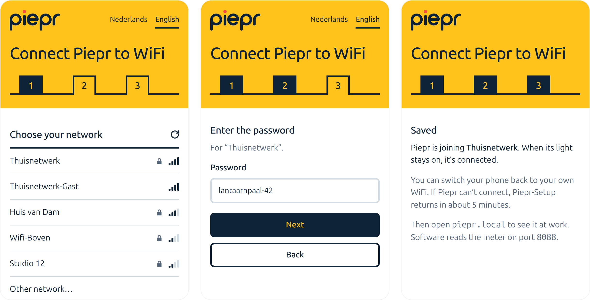
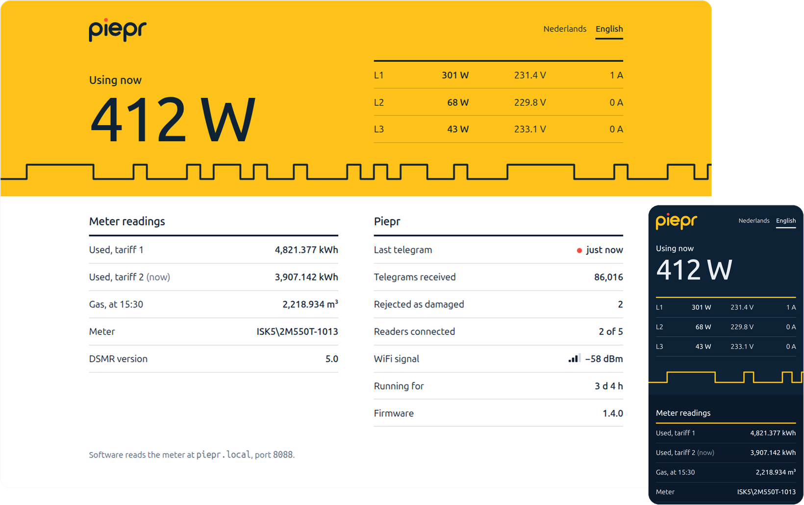

  

  
  
  

<a href="https://piepr.nl/en/">piepr.nl</a> · <a href="README.nl.md">Nederlands</a> · English

**Piepr** is a small open-source reader for Dutch and Belgian smart meters. Plug it
into the meter's P1 port, connect it to WiFi from your phone, and every reading is
available on your own network. No app, no account, no cloud.

- Reads every telegram from the P1 port and checks it (CRC) before passing it on
- Serves the raw telegrams at `piepr.local`, port `8088`, for any software that
  reads P1 data: Home Assistant (DSMR Smart Meter), Domoticz (P1 Smart Meter with LAN
  interface), DSMR-reader, or your own script; up to 5 at the same time
- A status page at `http://piepr.local`: is it reading the meter, the power right
  now, the meter readings
- WiFi setup from your phone, with a list of nearby networks
- Recovers by itself: when it can't join your WiFi, the setup hotspot comes back and
  says why
- About €5 in parts: an ESP32-C3 SuperMini (or a XIAO ESP32-S3), an RJ12 cable, a
  resistor and a diode
- Wired by hand, or on a small [circuit board](hardware/pcb) you can have made

  

## Using Piepr

1. Plug Piepr into the meter's **P1 port** and into a USB charger.
2. When the light **double-blinks**, join the WiFi network **Piepr-Setup** on your
   phone. The password is **piepr1234**, or your own `setup_pass` if you built the
   firmware yourself. The setup page opens by itself (otherwise browse to
   `http://192.168.4.1` while your phone is on Piepr-Setup).
3. Pick your home network, enter its password and save. Piepr works with
   **2.4 GHz** WiFi only.
4. When the light **stays on**, Piepr is connected. Open `http://piepr.local` in a
   browser to see what your meter says.
5. Point your software at `piepr.local`, port `8088`. In Home Assistant: Settings →
   Devices & services → Add integration → DSMR Smart Meter → Network. DSMR version:
   4 or 5, usually printed on the front of the meter; 5B in Belgium.

To change the WiFi later, hold the **BOOT** button until the light double-blinks
(about 5 seconds).

  

| Light | Meaning |
|---|---|
| on, with a short flicker per reading | connected and reading the meter |
| blinks evenly | looking for WiFi |
| double blink, then a pause | setup mode: join Piepr-Setup |

| Problem | What to do |
|---|---|
| Piepr-Setup isn't in your WiFi list | wait 5 minutes, or hold BOOT until the light double-blinks |
| Your network isn't listed | it must be 2.4 GHz with a good signal; move the router or an extender closer, or use *Other network…* |
| `piepr.local` doesn't work | find `piepr` in your router's device list and use its IP address |

## Meters

| Meter | P1 version | |
|---|---|---|
| Dutch smart meters | DSMR 4.x, 5.x | supported |
| Belgian digital meters (Fluvius) | e-MUCS P1 | supported; switch the user ports on first at [mijn.fluvius.be/poortbeheer](https://mijn.fluvius.be/poortbeheer) |

Piepr is developed on a Landis+Gyr E350 (DSMR 4.0). Something not working on your
meter? Open a [meter report](https://github.com/ViezeVingertjes/piepr/issues/new?template=meter-report.yml).

## Build your own

1. Hardware: parts list, wiring and checks in the [build guide](hardware/README.md).
2. Firmware: [install it from your browser](https://piepr.nl/en/install/), or build your
   own; see the [firmware guide](firmware/README.md).

| Folder | Contents |
|---|---|
| [`hardware/`](hardware) | Build guide, wiring diagrams and the [circuit board](hardware/pcb) |
| [`firmware/`](firmware) | ESP-IDF firmware, tests and fuzzers |
| [`assets/`](assets) | Logo and images |
| [`tools/`](tools) | A [pretend meter](firmware/docs/simulator.md) for testing, and the image script |

## License

MIT, see [LICENSE](LICENSE). The circuit board in [`hardware/pcb`](hardware/pcb) is under the
CERN Open Hardware Licence v2, Permissive.
