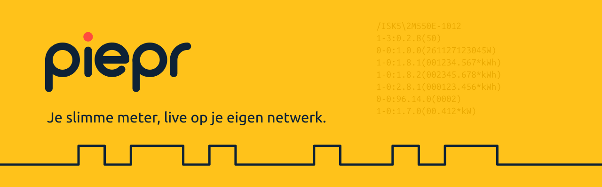
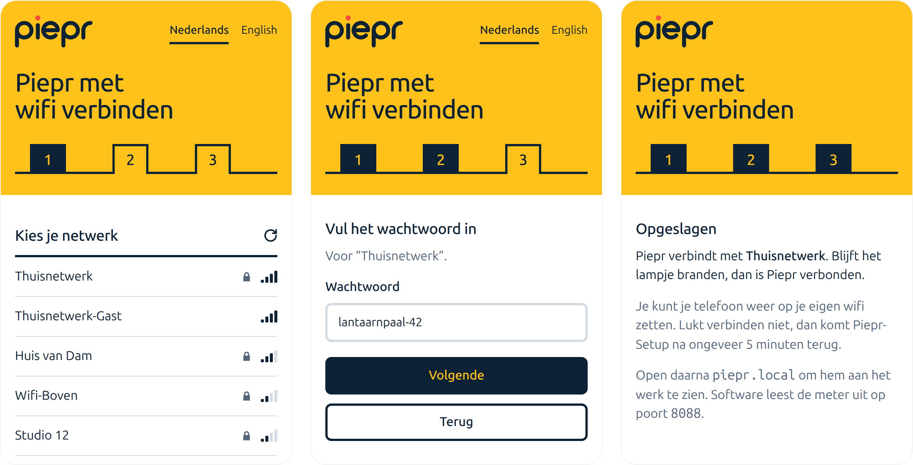
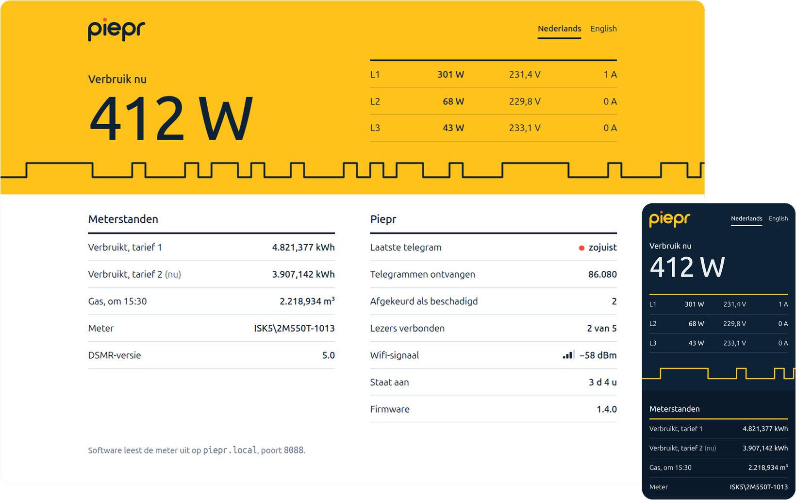

  

  
  
  

<a href="https://piepr.nl">piepr.nl</a> · Nederlands · <a href="README.md">English</a>

**Piepr** is een kleine open-source uitlezer voor Nederlandse en Belgische slimme
meters. Steek hem in de P1-poort van je meter, zet hem met je telefoon op wifi, en
elke meting staat op je eigen netwerk. Geen app, geen account, geen cloud.

- Leest elk telegram van de P1-poort en controleert het (CRC) voordat het wordt doorgegeven
- Geeft de ruwe telegrammen door op `piepr.local`, poort `8088`, aan alle software
  die P1-data leest: Home Assistant (DSMR Smart Meter), Domoticz (P1 Smart Meter with
  LAN interface), DSMR-reader of je eigen script; tot 5 tegelijk
- Een statuspagina op `http://piepr.local`: leest hij de meter, het vermogen van dit
  moment, de meterstanden
- Wifi stel je in op je telefoon: je kiest uit een lijst met netwerken in de buurt
- Herstelt zichzelf: komt hij niet op je wifi, dan komt de setup-hotspot terug en zie
  je waarom
- Ongeveer €5 aan onderdelen: een ESP32-C3 SuperMini (of een XIAO ESP32-S3), een
  RJ12-kabel, een weerstand en een diode
- Met de hand bedraad, of op een kleine [printplaat](hardware/pcb) die je kunt laten
  maken

  

## Piepr gebruiken

1. Steek Piepr in de **P1-poort** van de meter en in een USB-lader.
2. Zodra het lampje **dubbel knippert**, verbind je je telefoon met het wifi-netwerk
   **Piepr-Setup**. Het wachtwoord is **piepr1234**, of je eigen `setup_pass` als je
   de firmware zelf hebt gebouwd. De instelpagina opent vanzelf (zo niet, ga dan naar
   `http://192.168.4.1` terwijl je telefoon op Piepr-Setup zit).
3. Kies je thuisnetwerk, vul het wachtwoord in en sla op. Piepr werkt alleen met
   **2,4 GHz**-wifi.
4. Als het lampje **blijft branden**, is Piepr verbonden. Open `http://piepr.local` in
   een browser om te zien wat je meter aangeeft.
5. Vul in je software `piepr.local` in, met poort `8088`. In Home Assistant:
   Instellingen → Apparaten & diensten → Integratie toevoegen → DSMR Smart Meter →
   Netwerk. DSMR-versie: 4 of 5, staat meestal op de voorkant van de meter; 5B in
   België.

Later een ander wifi-netwerk instellen? Houd de **BOOT**-knop ingedrukt tot het lampje
dubbel knippert (ongeveer 5 seconden).

  

| Lampje | Betekenis |
|---|---|
| aan, met een korte flikkering per meting | verbonden en leest de meter |
| knippert gelijkmatig | zoekt wifi |
| knippert dubbel, dan een pauze | instelmodus: verbind met Piepr-Setup |

| Probleem | Wat je doet |
|---|---|
| Piepr-Setup staat niet in je wifi-lijst | wacht 5 minuten, of houd BOOT ingedrukt tot het lampje dubbel knippert |
| Je netwerk staat er niet bij | het moet 2,4 GHz zijn met een goed signaal; zet de router of een versterker dichterbij, of kies *Ander netwerk…* |
| `piepr.local` werkt niet | zoek `piepr` op in de apparatenlijst van je router en gebruik het IP-adres |

## Meters

| Meter | P1-versie | |
|---|---|---|
| Nederlandse slimme meters | DSMR 4.x, 5.x | ondersteund |
| Belgische digitale meters (Fluvius) | e-MUCS P1 | ondersteund; zet eerst de gebruikerspoorten aan op [mijn.fluvius.be/poortbeheer](https://mijn.fluvius.be/poortbeheer) |

Piepr wordt ontwikkeld op een Landis+Gyr E350 (DSMR 4.0). Werkt er iets niet op jouw
meter? Maak een [metermelding](https://github.com/ViezeVingertjes/piepr/issues/new?template=meter-report.yml).

## Zelf bouwen

1. Hardware: onderdelenlijst, bedrading en controles in de [bouwgids](hardware/README.nl.md).
2. Firmware: [installeer hem vanuit je browser](https://piepr.nl/installeren/), of bouw hem
   zelf; zie de [firmwaregids](firmware/README.md) (Engels).

| Map | Inhoud |
|---|---|
| [`hardware/`](hardware) | Bouwgids, bedradingsschema's en de [printplaat](hardware/pcb) |
| [`firmware/`](firmware) | ESP-IDF-firmware, tests en fuzzers |
| [`assets/`](assets) | Logo en afbeeldingen |
| [`tools/`](tools) | Een [nepmeter](firmware/docs/simulator.md) om mee te testen (Engels), en het script voor de afbeeldingen |

## Licentie

MIT, zie [LICENSE](LICENSE). De printplaat in [`hardware/pcb`](hardware/pcb) valt onder de
CERN Open Hardware Licence v2, Permissive.
