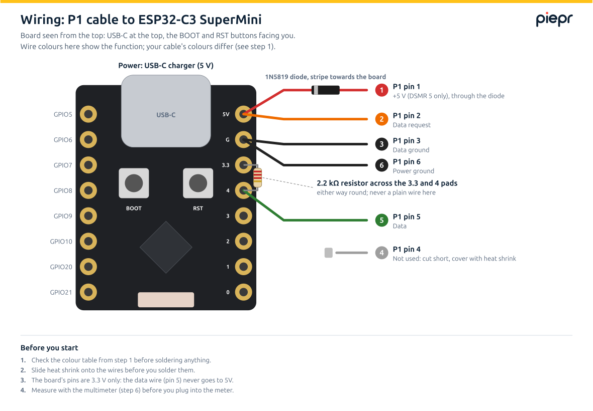
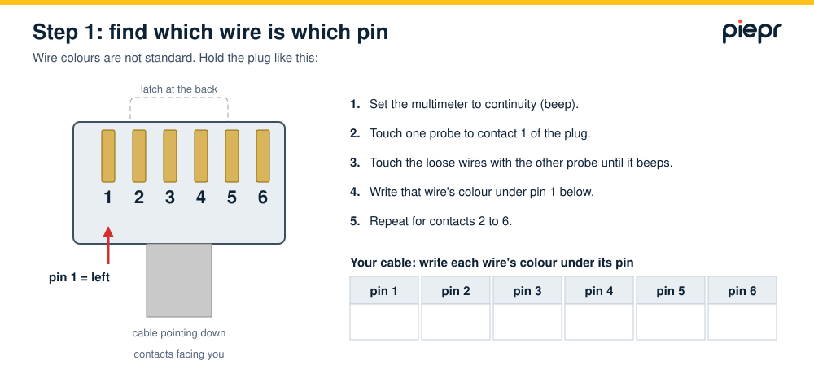
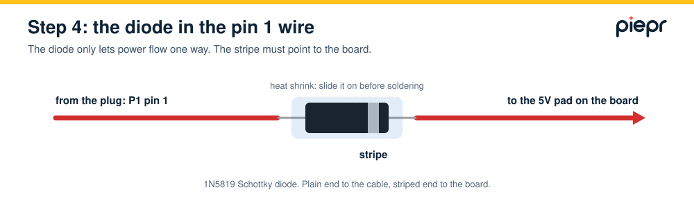

# Building Piepr

[Nederlands](README.nl.md) · English

Everything you need to build your own Piepr: parts, wiring and checks. It takes an
evening with a soldering iron and a multimeter.

## 1. Parts

Building your first Piepr costs about €16 delivered from AliExpress; the parts
in one Piepr are worth about €5.40, so the spares go a long way. The first four
packs ship free together (order over €10); the diodes ship separately. Prices
checked 27 Nov 2026 (Netherlands). Links die and prices change: the search term
always works.

| Part | Get | Pack | Per Piepr | Search term |
|---|---|---|---|---|
| ESP32-C3 SuperMini (not "Plus") | [1 board](https://www.aliexpress.com/item/1005006860780404.html) | €3.79 | €3.79 | `ESP32-C3 SuperMini` |
| RJ12 **6P6C** cable (all 6 wires), cut in half | [1 m, variant BK1-1M](https://www.aliexpress.com/item/1005005985195084.html) | €2.96 | €1.48 | `RJ12 6P6C cable` |
| Resistor **2.2 kΩ**, 1/4 W (1–4.7 kΩ works) | [100, variant 2.2K](https://www.aliexpress.com/item/1005005669886834.html) | €2.40 | €0.02 | `2.2K 1/4W resistor` |
| Heat shrink, 2 mm and 3 mm | [kit of 127](https://www.aliexpress.com/item/1005008123196951.html) | €1.99 | €0.05 | `heat shrink kit` |
| Schottky diode **1N5819** (DO-41) | [100](https://www.aliexpress.com/item/32886942865.html) | €1.18 + €3.53 shipping | €0.01 | `1N5819 DO-41` |
| Total | | €15.85 | €5.35 | |
| USB-C cable (USB-A to C) + 5 V USB charger | most people have these | | | `5V USB charger` |
| Optional: 470–1000 µF capacitor | only if a DSMR 5 meter powers the board | | | `1000uF 10V capacitor` |

Use a **USB-A to USB-C** cable: many SuperMini clones don't power up from a
USB-C-to-C (PD) charger. Any 5 V charger is strong enough: the board draws about
0.08 A, and about 0.12 A at most.

Tools: soldering iron, multimeter (beep mode + DC volts), wire stripper, lighter or heat gun.

---

## 2. Pin mapping

Board top view, **USB-C up**: the right-hand row is
`5V, G, 3.3, 4, 3, 2, 1, 0` (as printed on the board).

| P1 pin | Function | Inline part | → Board pad |
|---|---|---|---|
| 1 | +5 V from the meter (up to 250 mA on DSMR 5, 100 mA on DSMR 4) | **1N5819**, stripe → board | 5V |
| 2 | Data Request (must be high) | | 5V |
| 3 | Data GND | | G |
| 4 | not used | | cut short, insulate |
| 5 | Data (inverted, open collector) | | **4** (GPIO4) |
| 6 | Power GND | | G |
| | **2.2 kΩ pull-up** | | **3.3 ↔ 4** (neighbouring pads) |

Belgian meters behave like DSMR 5 throughout this guide: 5 V on pin 1 and a telegram
every second.

Don't use GPIO2, GPIO8 or GPIO9 (strapping pins; GPIO8 is the LED, GPIO9 BOOT).

---

## 3. Build steps

### Step 1: Match wire colours to pins (most important)
Colours aren't standard. Hold the plug **contacts facing you, latch at the back,
cable down**: pin 1 is on the **left** (check the seller's photo too). With the
multimeter in beep mode, find which loose wire belongs to each contact.

| P1 pin | 1 | 2 | 3 | 4 | 5 | 6 |
|---|---|---|---|---|---|---|
| wire colour | | | | | | |

### Step 2 (optional): Measure at the meter
Plug into the meter with the loose ends apart. DC volts:
- pin 1 vs pin 6: ~5 V. If a DSMR 4 meter shows 0 V here, carry on: the board runs
  from USB.
- pin 5 vs pin 3: ~0 V (normal without pull-up).

Unplug before soldering.

### Step 3: Resistor
Solder the resistor **across the 3.3 and 4 pads** (either way round). Leave room in
the 4 hole for the data wire, or solder both to the pad. Heat shrink on long legs.

### Step 4: Diode in the pin 1 wire
**Plain end → P1 wire, stripe → board.** Slide 3 mm heat shrink on first, then
cover the diode.

### Step 5: Wires to the board
See the wiring diagram at the top of this page.
- **5V:** pin 2 + the diode's stripe end (pin 1)
- **G:** pin 3 + pin 6
- **4:** pin 5 (next to the resistor leg)
- **Pin 4:** cut short, heat shrink

### Step 6: Check before power-up (nothing plugged in)
| Measure | Expected |
|---|---|
| 3.3 ↔ 4 | ≈ 2.2 kΩ |
| 5V ↔ G | no beep |
| 3.3 ↔ G | no beep |
| 4 ↔ 5V | no beep |
| plug pin 5 ↔ pad 4 | beep |
| plug pin 2 ↔ 5V | beep |
| plug pins 3 and 6 ↔ G | beep |
| plug pin 1 → 5V (diode mode, red probe on pin 1) | ~0.2–0.3 V; reversed: OL |

### Step 7: Flash the firmware before connecting to the meter
[Install the firmware from your browser](https://piepr.nl/en/install/), or build your own; see the
[firmware guide](../firmware/README.md). Without a meter the log shows
`p1: last 60s: ok 0 …` every minute; that's expected.

### Step 8: Connect to the meter
1. Plug the RJ12 into the P1 socket (E350: under the "P1 ▼" flap, from below).
2. Power the board from a USB charger and set up WiFi from your phone (see
   [Using Piepr](../README.md#using-piepr)).
3. Telegrams arrive every 10 s (DSMR 4) or every second (DSMR 5). Gas updates
   hourly (DSMR 4) or every 5 minutes (DSMR 5); *returned energy* stays 0 without solar panels.

### Changing WiFi later
Hold **BOOT** until the light double-blinks (about 5 s); Piepr restarts as hotspot
`Piepr-Setup`. See
the [firmware guide](../firmware/README.md).

---

## 4. Troubleshooting

| Symptom | Fix |
|---|---|
| No data | pin 2 not at 5 V; wrong wire on pad 4; pull-up missing; colour mix-up (redo step 1) |
| `crc` / `uart errors` high in the log | check the 2.2 kΩ pull-up and the data wire on pad 4 |
| WiFi drops (RSSI worse than −80 dBm) | the signal at the meter is too weak: put an access point closer, or solder a 31 mm wire to the board's antenna |
| Board not seen over USB | data-capable cable? `dialout` group? Hold BOOT, tap RST, release BOOT |
| Random resets | weak charger; if a DSMR 5 meter powers the board, add 470–1000 µF across 5V and G |

## Safety
- The P1 port is low voltage and isolated from the mains; you don't touch 230 V.
- **Never break the meter's seals**; the P1 flap isn't sealed.
- Never a plain wire between 3.3 and 4: only the resistor.
- Board pins are 3.3 V only: P1 data (pin 5) never goes to 5 V.

## Reference
P1 port pinout and signals: *DSMR P1 Companion Standard* (Netbeheer Nederland).
