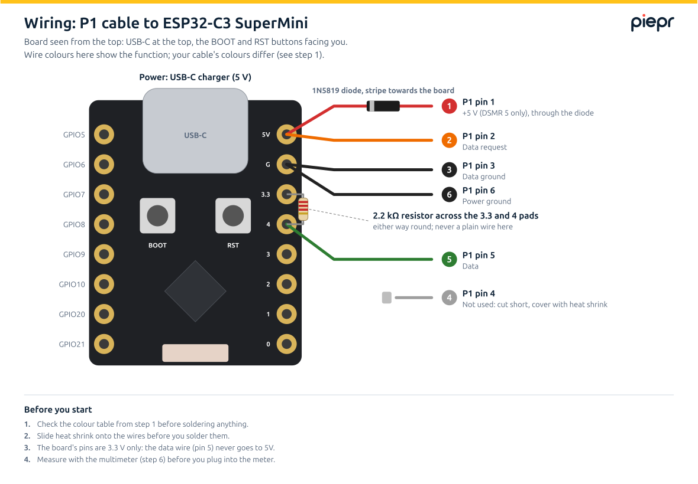
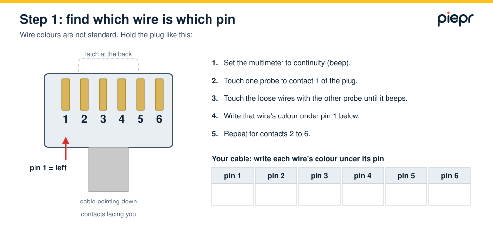
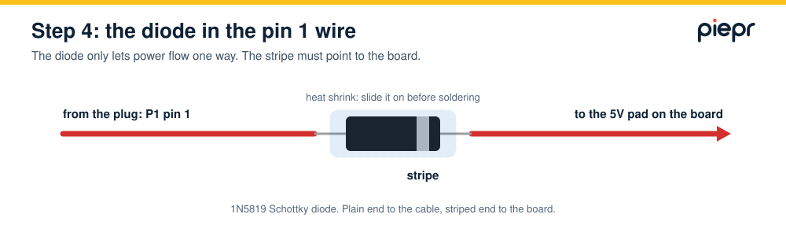

# Piepr bouwen

Nederlands · [English](README.md)

Alles om je eigen Piepr te bouwen: onderdelen, bedrading en controles. Reken op een
avond met een soldeerbout en een multimeter.

De afbeeldingen zijn in het Engels.

## 1. Onderdelen

Je eerste Piepr kost ongeveer €16 inclusief verzending bij AliExpress; in één Piepr
zit voor ongeveer €5,40 aan onderdelen, dus je houdt flink wat over. De eerste vier
pakketjes worden samen gratis verzonden (bestelling boven €10); de diodes worden apart
verzonden.
Prijzen bekeken op 27 nov 2026 (Nederland). Links verdwijnen en prijzen veranderen:
de zoekterm werkt altijd.

| Onderdeel | Bestellen | Verpakking | Per Piepr | Zoekterm |
|---|---|---|---|---|
| ESP32-C3 SuperMini (niet "Plus") | [1 bordje](https://www.aliexpress.com/item/1005006860780404.html) | €3,79 | €3,79 | `ESP32-C3 SuperMini` |
| RJ12-kabel **6P6C** (alle 6 aders), doormidden geknipt | [1 m, variant BK1-1M](https://www.aliexpress.com/item/1005005985195084.html) | €2,96 | €1,48 | `RJ12 6P6C cable` |
| Weerstand **2,2 kΩ**, 1/4 W (1–4,7 kΩ werkt ook) | [100 stuks, variant 2.2K](https://www.aliexpress.com/item/1005005669886834.html) | €2,40 | €0,02 | `2.2K 1/4W resistor` |
| Krimpkous, 2 mm en 3 mm | [set van 127](https://www.aliexpress.com/item/1005008123196951.html) | €1,99 | €0,05 | `heat shrink kit` |
| Schottky-diode **1N5819** (DO-41) | [100 stuks](https://www.aliexpress.com/item/32886942865.html) | €1,18 + €3,53 verzending | €0,01 | `1N5819 DO-41` |
| Totaal | | €15,85 | €5,35 | |
| USB-C-kabel (USB-A naar C) + USB-lader van 5 V | heeft bijna iedereen liggen | | | `5V USB charger` |
| Optioneel: condensator van 470–1000 µF | alleen als een DSMR 5-meter het bordje voedt | | | `1000uF 10V capacitor` |

Neem een kabel van **USB-A naar USB-C**: veel SuperMini-klonen starten niet op aan een
lader met USB-C naar C (PD). Elke lader van 5 V is sterk genoeg: het bordje gebruikt
ongeveer 0,08 A, en hooguit ongeveer 0,12 A.

Gereedschap: soldeerbout, multimeter (pieptoon + gelijkspanning), striptang, aansteker
of heteluchtpistool.

---

## 2. Aansluitingen

Bordje van boven gezien, **USB-C naar boven**: de rechterrij is
`5V, G, 3.3, 4, 3, 2, 1, 0` (zoals op het bordje staat).

| P1-pin | Functie | Onderdeel ertussen | → Soldeervlakje |
|---|---|---|---|
| 1 | +5 V uit de meter (tot 250 mA bij DSMR 5, 100 mA bij DSMR 4) | **1N5819**, streepje → bordje | 5V |
| 2 | Data Request (moet hoog zijn) | | 5V |
| 3 | Data-GND | | G |
| 4 | niet gebruikt | | kort afknippen, isoleren |
| 5 | Data (geïnverteerd, open collector) | | **4** (GPIO4) |
| 6 | Voedings-GND | | G |
| | **Pull-up van 2,2 kΩ** | | **3.3 ↔ 4** (liggen naast elkaar) |

Belgische meters gedragen zich in deze gids als DSMR 5: 5 V op pin 1 en elke seconde
een telegram.

Gebruik GPIO2, GPIO8 en GPIO9 niet (strapping-pinnen; GPIO8 is het lampje, GPIO9 de
BOOT-knop).

---

## 3. Bouwen

### Stap 1: Welke draadkleur hoort bij welke pin (het belangrijkste)
De kleuren liggen niet vast. Houd de stekker met de **contacten naar je toe, het lipje
aan de achterkant, de kabel naar beneden**: pin 1 zit **links** (kijk ook op de foto
van de verkoper). Zet de multimeter op de pieptoon en zoek bij elk contact de losse
draad die erbij hoort.

| P1-pin | 1 | 2 | 3 | 4 | 5 | 6 |
|---|---|---|---|---|---|---|
| draadkleur | | | | | | |

### Stap 2 (optioneel): Meten aan de meter
Steek de stekker in de meter en houd de losse draadeinden uit elkaar. Gelijkspanning:
- pin 1 tegen pin 6: ~5 V. Meet je bij een DSMR 4-meter 0 V, ga dan gewoon door: het
  bordje krijgt stroom via USB.
- pin 5 tegen pin 3: ~0 V (normaal zonder pull-up).

Haal de stekker eruit voordat je gaat solderen.

### Stap 3: Weerstand
Soldeer de weerstand **tussen de vlakjes 3.3 en 4** (de richting maakt niet uit). Houd
in het gaatje van 4 ruimte over voor de datadraad, of soldeer beide op het vlakje.
Krimpkous om lange pootjes.

### Stap 4: Diode in de draad van pin 1
**Kant zonder streepje → P1-draad, streepje → bordje.** Schuif eerst 3 mm krimpkous over de draad
en krimp die daarna over de diode.

### Stap 5: Draden aan het bordje
Zie het bedradingsschema bovenaan deze pagina.
- **5V:** pin 2 + de streepjeskant van de diode (pin 1)
- **G:** pin 3 + pin 6
- **4:** pin 5 (naast het pootje van de weerstand)
- **Pin 4:** kort afknippen, krimpkous erom

### Stap 6: Controleren voordat er spanning op komt (niets aangesloten)
| Meet | Verwacht |
|---|---|
| 3.3 ↔ 4 | ≈ 2,2 kΩ |
| 5V ↔ G | geen piep |
| 3.3 ↔ G | geen piep |
| 4 ↔ 5V | geen piep |
| stekkerpin 5 ↔ vlakje 4 | piep |
| stekkerpin 2 ↔ 5V | piep |
| stekkerpinnen 3 en 6 ↔ G | piep |
| stekkerpin 1 → 5V (diodestand, rode meetpen op pin 1) | ~0,2–0,3 V; andersom: OL |

### Stap 7: Flash de firmware voordat je de meter aansluit
[Installeer de firmware vanuit je browser](https://piepr.nl/installeren/), of bouw hem zelf; zie de
[firmwaregids](../firmware/README.md) (Engels). Zonder meter staat er elke minuut
`p1: last 60s: ok 0 …` in het log; dat klopt.

### Stap 8: Aansluiten op de meter
1. Steek de RJ12-stekker in de P1-aansluiting (E350: onder het klepje "P1 ▼", van onderaf).
2. Sluit het bordje aan op een USB-lader en stel wifi in op je telefoon (zie
   [Piepr gebruiken](../README.nl.md#piepr-gebruiken)).
3. Er komt elke 10 s een telegram (DSMR 4) of elke seconde (DSMR 5). Gas wordt elk
   uur bijgewerkt (DSMR 4) of elke 5 minuten (DSMR 5); *teruggeleverde energie* blijft 0 zonder zonnepanelen.

### Later een ander wifi-netwerk
Houd **BOOT** ingedrukt tot het lampje dubbel knippert (ongeveer 5 s); Piepr start
opnieuw op als hotspot `Piepr-Setup`. Zie
de [firmwaregids](../firmware/README.md) (Engels).

---

## 4. Problemen oplossen

| Wat je ziet | Oplossing |
|---|---|
| Geen data | pin 2 staat niet op 5 V; verkeerde draad op vlakje 4; pull-up ontbreekt; kleuren verwisseld (doe stap 1 opnieuw) |
| `crc` / `uart errors` hoog in het log | controleer de pull-up van 2,2 kΩ en de datadraad op vlakje 4 |
| Wifi valt weg (RSSI slechter dan −80 dBm) | het signaal bij de meter is te zwak: zet een accesspoint dichterbij, of soldeer een draad van 31 mm aan de antenne van het bordje |
| Bordje verschijnt niet via USB | kabel met datalijnen? groep `dialout`? Houd BOOT ingedrukt, druk kort op RST, laat BOOT los |
| Herstart zomaar | zwakke lader; voedt een DSMR 5-meter het bordje, zet dan 470–1000 µF tussen 5V en G |

## Veiligheid
- De P1-poort is laagspanning en gescheiden van het lichtnet; je komt niet aan 230 V.
- **Verbreek nooit de zegels van de meter**; het P1-klepje is niet verzegeld.
- Nooit een gewone draad tussen 3.3 en 4: alleen de weerstand.
- De pinnen van het bordje kunnen alleen tegen 3,3 V: P1-data (pin 5) gaat nooit naar 5 V.

## Bron
Pinbezetting en signalen van de P1-poort: *DSMR P1 Companion Standard* (Netbeheer Nederland).
