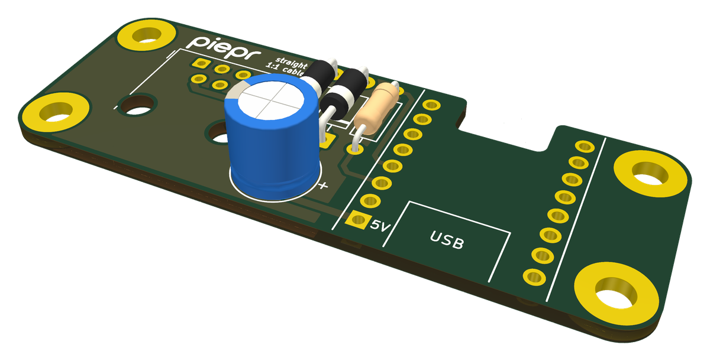
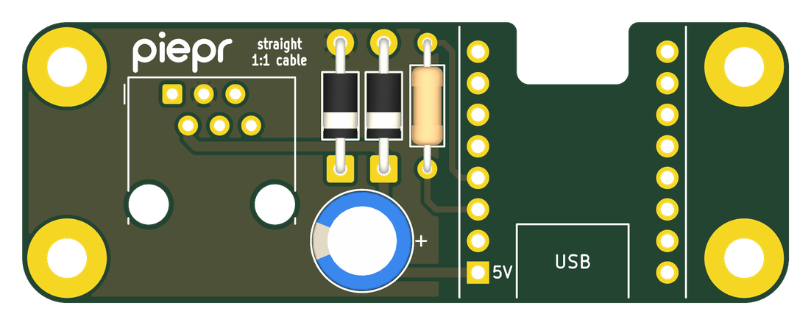
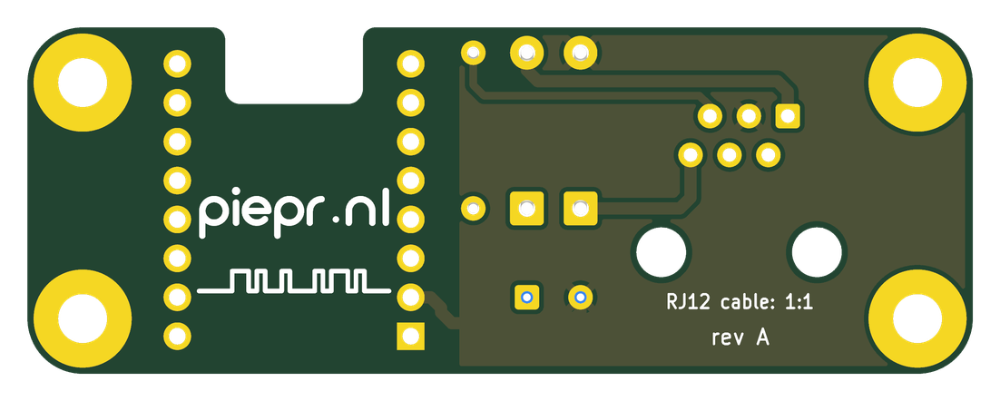

# Piepr P1 board

A small board that replaces the hand-wired cable of the [build guide](../README.md):
the ESP32-C3 SuperMini, an RJ12 socket, the pull-up resistor and two diodes on one
board, connected to the meter with an ordinary RJ12 cable. Revision A.

The pictures show the board with its small parts; the socket and the SuperMini are
left out.

61.7 × 22.6 mm, two layers, through-hole parts only. Made in KiCad 10; the files open
without anything else installed.

## Parts

| | Part | Notes |
|---|---|---|
| U1 | ESP32-C3 SuperMini (not "Plus") with its pin headers soldered on | the pins that are not used go through holes without tracks |
| J1 | RJ12 **6P6C** socket for PCBs, horizontal, unshielded: type `95001-6P6C` or `53-6P6C`, or Amphenol 54601-906 | |
| R1 | 2.2 kΩ resistor, 1/4 W | 1 to 4.7 kΩ works too |
| D1, D2 | 2 × 1N5819 Schottky diode (DO-41) | both with the band towards the capacitor, as printed. D1 keeps USB power out of the meter; D2 keeps the meter's 5 V out of the board when the cable is the wrong kind |
| C1 | optional: 470 µF electrolytic capacitor, 16 V, **8 mm wide, pins 3.5 mm apart** | extra reserve for a DSMR 5 meter that powers the board without USB. To go without, leave its place empty; never bridge it, that would short 5 V to ground |
| | RJ12 cable 6P6C, **straight (1:1)** | see below |
| | 4 × M3 standoffs and screws | optional; the holes are plated and not connected to anything |

## The cable must be straight

Pin 1 of one plug has to arrive at pin 1 of the other. Many flat telephone cords are
reversed (pin 1 to pin 6). With one of those Piepr does not work: it gets no data, or
stays dark without USB power. D2 is there so that nothing gets damaged. Check a new
cable with a multimeter on continuity before use: hold both plugs the same way, as in
[step 1 of the build guide](../README.md), and the contacts in the same position must
beep.

## Ordering

The board follows [AISLER](https://aisler.net)'s rules for their two-layer boards
(1.6 mm, HASL): upload `piepr.kicad_pcb` as it is. The rules are in the project
(`piepr.kicad_pro`, `piepr.kicad_dru`), so KiCad's own check (Inspect → Design Rules
Checker) tests against them.

## Soldering

R1 and the diodes first, then the SuperMini, the socket, and last the capacitor if you
use it (long leg in the hole next to the +). The SuperMini goes in with its USB-C
socket over the box marked USB and its `5V` pin in the square pad. Solder everything
on the bottom.

Before plugging anything in, check both diodes with the multimeter's diode test:

| Red probe | Black probe | Reads |
|---|---|---|
| any ground pad (the SuperMini's `G`) | socket pin 6 | 0.15 to 0.35 V; with the probes swapped: no reading |
| socket pin 1 (the square pad) | the SuperMini's `5V` | 0.15 to 0.35 V; with the probes swapped: no reading |

The first row matters most: the board also works with D2 the wrong way round, so
this test is the only way to notice.

The SuperMini's pins stick out about 4.5 mm under the board: standoffs must be 5 mm
or longer.

Then [install the firmware](https://piepr.nl/en/install/) and connect it to the meter
as in [step 8 of the build guide](../README.md). With a DSMR 4 meter the board also
needs USB power.

## Licence

Copyright ViezeVingertjes 2026.

This source describes Open Hardware and is licensed under the CERN-OHL-P v2. You may
redistribute and modify it under the terms of the
[CERN-OHL-P v2](https://ohwr.org/cern_ohl_p_v2.txt). It is distributed WITHOUT ANY
EXPRESS OR IMPLIED WARRANTY, INCLUDING OF MERCHANTABILITY, SATISFACTORY QUALITY AND
FITNESS FOR A PARTICULAR PURPOSE. See [LICENSE](LICENSE) for the conditions. The
firmware and the rest of this repository are under the MIT licence.
